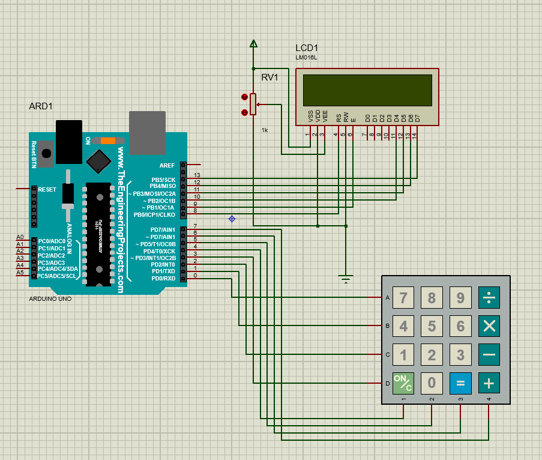

# Calculatrice Arduino

Ce projet réalise une calculatrice commandée par un clavier matriciel. Le résultat est affiché sur un écran LCD.

## Fichiers

- [Code Arduino](Code.ino)
- [Montage Proteus](Montage.pdsprj)
- [Image du projet](image.png)

Ouvrez le montage avec Proteus et le programme avec l'IDE Arduino. Vérifiez la bibliothèque du clavier matriciel avant la compilation.
