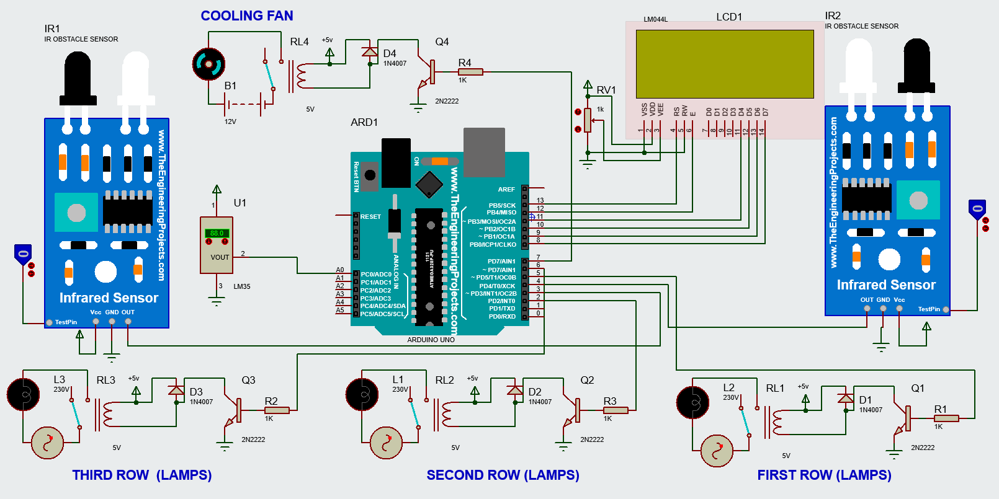

# Compteur, éclairage ambiant et régulateur de température

Ce projet associe le comptage par capteurs infrarouges à une commande d'éclairage et à un volet de régulation de température.

## Fichiers

- [Code Arduino](Code.ino)
- [Montage Proteus](Montage.pdsprj)
- [Image du projet](image.png)

Ouvrez le montage avec Proteus et le programme avec l'IDE Arduino. Consultez le code pour les broches et les composants utilisés.
