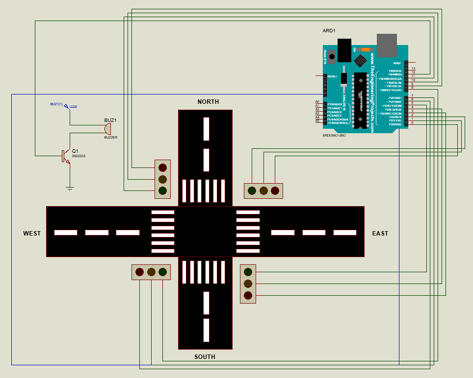

# Contrôle de feux de circulation

Ce projet commande des feux de circulation à l'aide d'une carte Arduino et d'une séquence de signalisation.

## Fichiers

- [Code Arduino](Code.ino)
- [Montage Proteus](Montage.pdsprj)
- [Image du projet](image.png)

Ouvrez le montage avec Proteus et le programme avec l'IDE Arduino. Les sorties et leur séquence sont définies dans le code.
