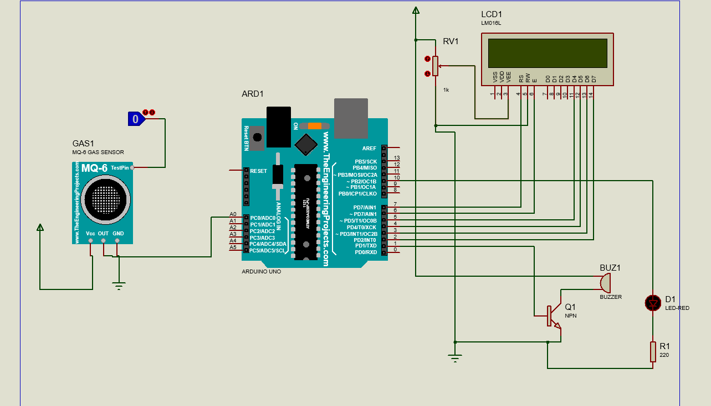

# Détecteur de fuite de gaz GPL

Ce montage détecte la présence de gaz et utilise un écran LCD, une LED et un buzzer pour signaler l'état détecté.

## Fichiers

- [Code Arduino](Code.ino)
- [Montage Proteus](Montage.pdsprj)
- [Image du projet](image.png)

Ouvrez le montage avec Proteus et le programme avec l'IDE Arduino. Ce prototype est destiné à l'étude et ne remplace pas un détecteur de gaz certifié.
