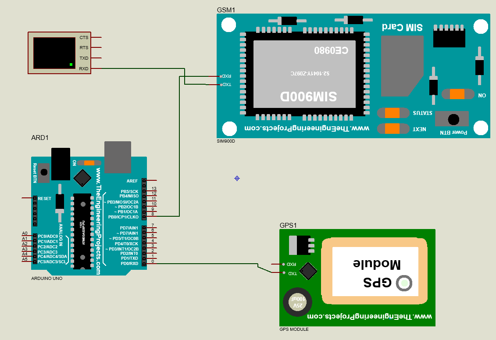

# Envoi de données de localisation GPS via GSM

Ce projet lit des données GPS et prévoit leur transmission à l'aide d'un module GSM.

## Fichiers

- [Code Arduino](Code.ino)
- [Montage Proteus](Montage.pdsprj)
- [Image du projet](image.png)

Le code utilise les bibliothèques TinyGPS et SoftwareSerial. Vérifiez leur disponibilité ainsi que la configuration du module GPS/GSM avant l'utilisation.
