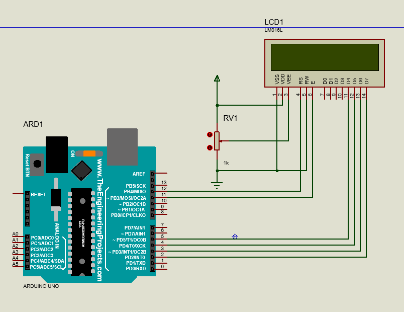

# Guide de connexion d'un afficheur LCD 16x2 à un Arduino

Un exemple de câblage et de commande d'un écran LCD 16x2 par Arduino, accompagné de son montage Proteus.

## Fichiers

- [Code Arduino](Code.ino)
- [Montage Proteus](Montage.pdsprj)
- [Image du projet](image.png)

Consultez les broches déclarées dans le code pour reproduire le câblage du montage.
