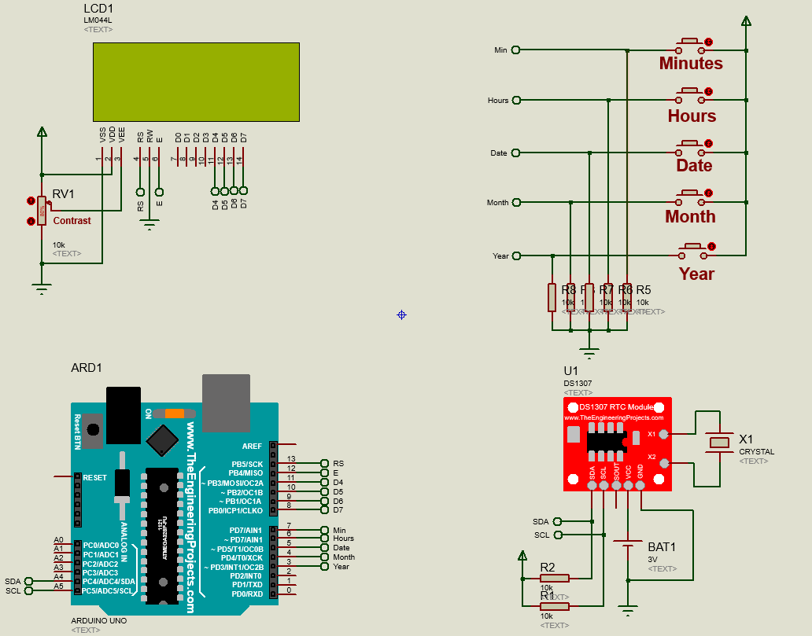

# Horloge numérique — date et heure

Ce projet affiche la date et l'heure sur un écran LCD à partir d'un module d'horloge temps réel DS1307.

## Fichiers

- [Code Arduino](Code.ino)
- [Montage Proteus](Montage.pdsprj)
- [Image du projet](image.png)

Le programme utilise la bibliothèque DS1307. Vérifiez son installation et le réglage initial de l'heure avant l'utilisation.
