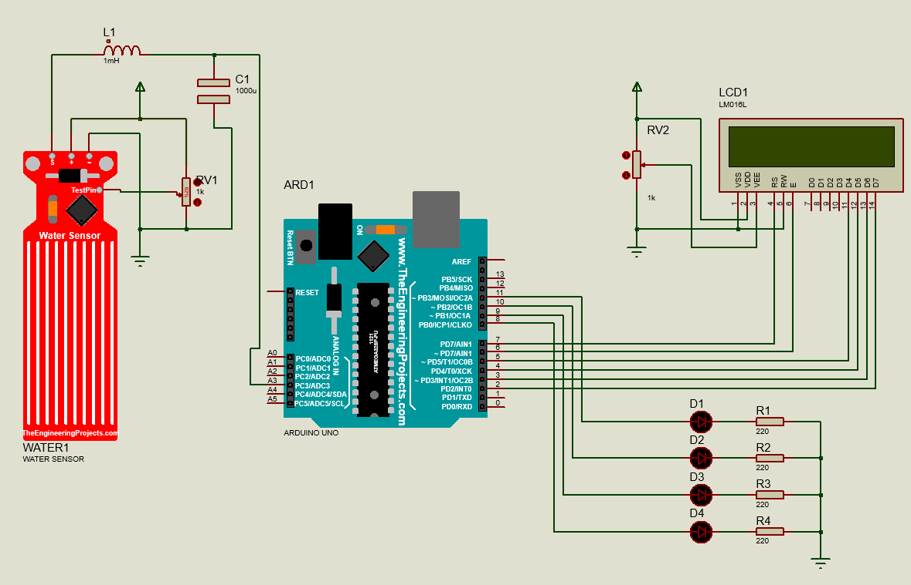

# Projet de capteurs d'eau

Ce projet met en œuvre des capteurs liés à l'eau et affiche leur état avec un écran LCD et des indicateurs LED.

## Fichiers

- [Code Arduino](Code.ino)
- [Montage Proteus](Montage.pdsprj)
- [Image du projet](image.png)

Consultez le code et le montage pour identifier les capteurs, leurs broches et les seuils utilisés.
