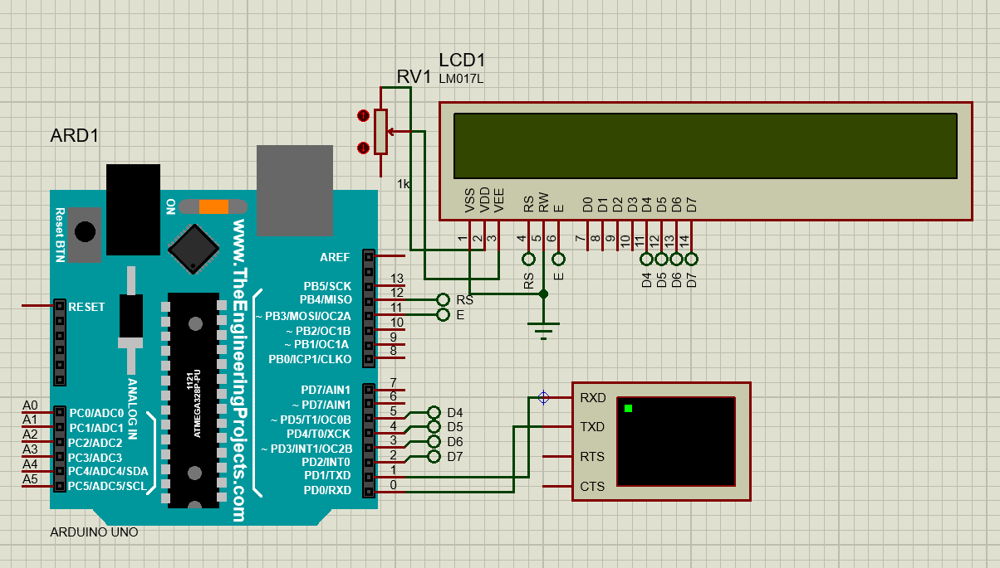

# Sécurité IoT à base d'Arduino

Ce projet présente un prototype de sécurité et de contrôle construit autour d'Arduino et de l'IoT.

## Fichiers

- [Code Arduino](Code.ino)
- [Montage Proteus](Montage.pdsprj)
- [Image du projet](image.png)

Consultez le code pour les messages, les modes et les composants configurés dans le projet.
