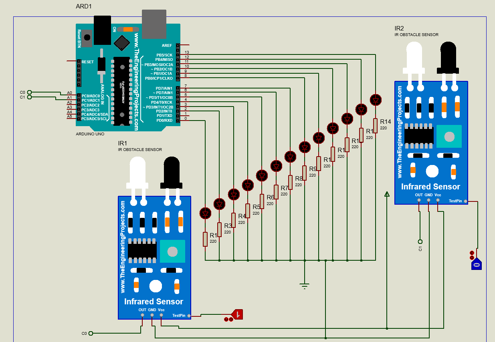

# Système d'éclairage automatique d'escalier

Ce projet utilise des capteurs infrarouges pour commander l'éclairage d'un escalier automatiquement.

## Fichiers

- [Code Arduino](Code.ino)
- [Montage Proteus](Montage.pdsprj)
- [Image du projet](image.png)

Consultez le code pour les broches des capteurs et des LED, puis ouvrez le montage dans Proteus.
