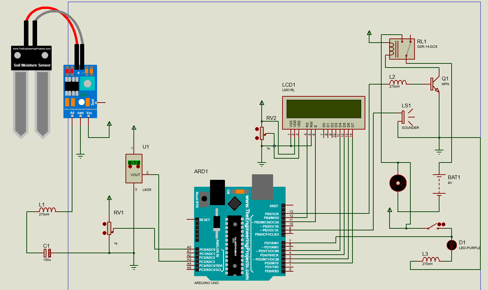

# Système d'irrigation intelligent

Ce projet automatise un système d'irrigation avec Arduino. Le montage et le programme associés sont fournis pour l'étude et la simulation.

## Fichiers

- [Code Arduino](Code.ino)
- [Montage Proteus](Montage.pdsprj)
- [Image du projet](image.png)

Ouvrez le montage avec Proteus et consultez le code pour repérer les entrées, sorties et composants prévus.
