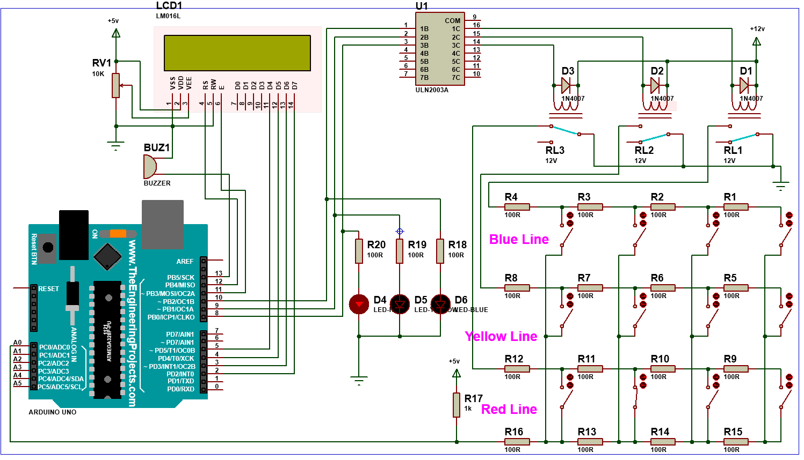

# Détection de défauts de câbles souterrains avec emplacement

Ce projet vise à détecter un défaut sur un câble souterrain et à présenter les informations associées. Le code comporte notamment un affichage LCD et des sorties de commande.

## Fichiers

- [Code Arduino](Code.ino)
- [Montage Proteus](Montage.pdsprj)
- [Image du projet](image.png)

Ouvrez le montage avec Proteus et consultez le code pour les entrées, sorties et paramètres du prototype.
