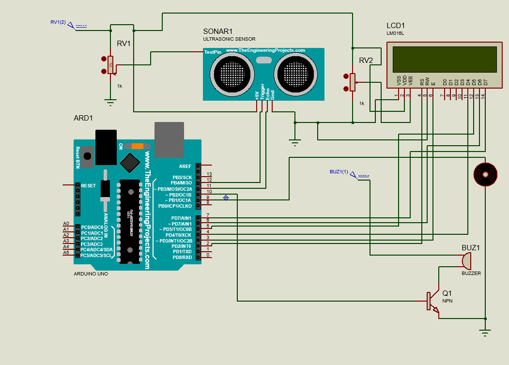

# Bâton intelligent pour aveugle

Ce prototype d'aide à la mobilité utilise un capteur ultrasonique pour repérer les obstacles et un buzzer pour avertir l'utilisateur.

## Fichiers

- [Code Arduino](Code.ino)
- [Montage Proteus](Montage.pdsprj)
- [Image du projet](image.png)

Le code utilise également un écran LCD. Consultez les broches et le seuil de distance configurés avant de reproduire le montage.
