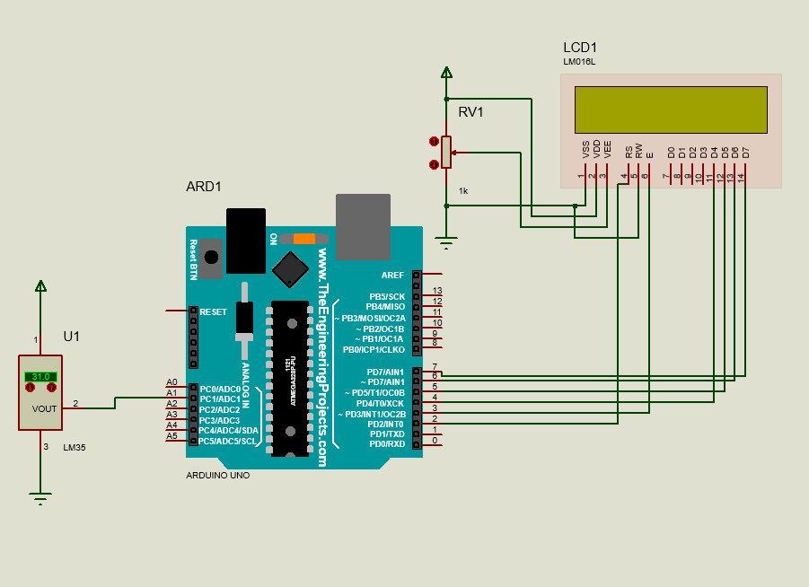

# Capteur de température

Ce projet lit une valeur analogique liée à la température et l'affiche sur un écran LCD.

## Fichiers

- [Code Arduino](Code.ino)
- [Montage Proteus](Montage.pdsprj)
- [Image du projet](image.png)

Consultez le code pour connaître l'entrée analogique et la conversion utilisée.
