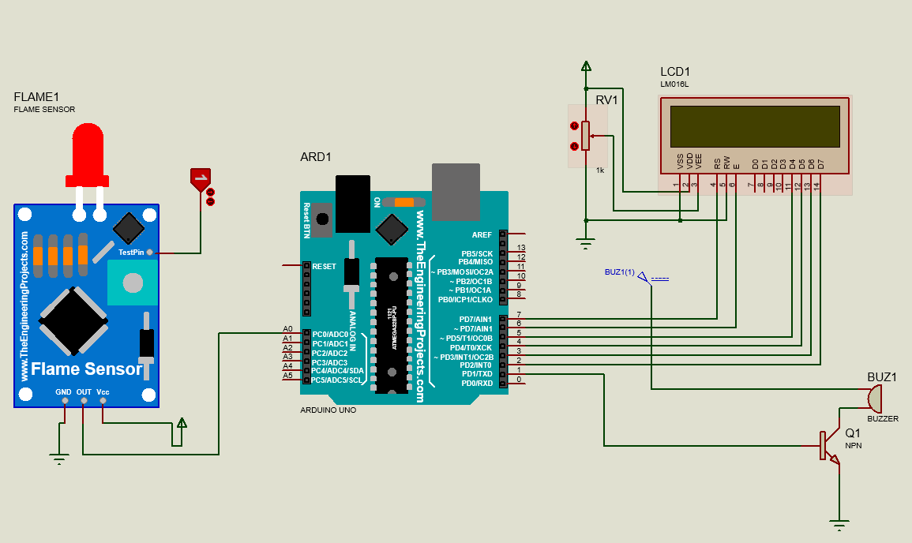

# Détecteur de flamme

Ce projet détecte une flamme et signale l'état détecté par un buzzer et un écran LCD.

## Fichiers

- [Code Arduino](Code.ino)
- [Montage Proteus](Montage.pdsprj)
- [Image du projet](image.png)

Ouvrez le montage avec Proteus et vérifiez le type de capteur ainsi que la logique d'alerte dans le code.
