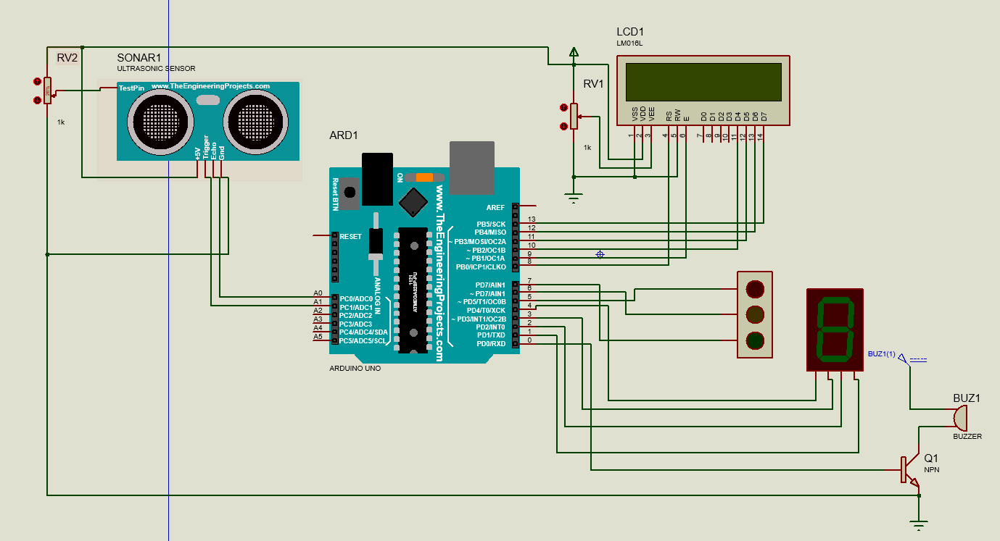

# Système de feux de signalisation — projet 2

Deuxième exemple du dépôt pour commander des feux de signalisation avec Arduino.

## Fichiers

- [Code Arduino](Code.ino)
- [Montage Proteus](Montage.pdsprj)
- [Image du projet](image.png)

Consultez le code pour la séquence des feux et ouvrez le montage avec Proteus.
